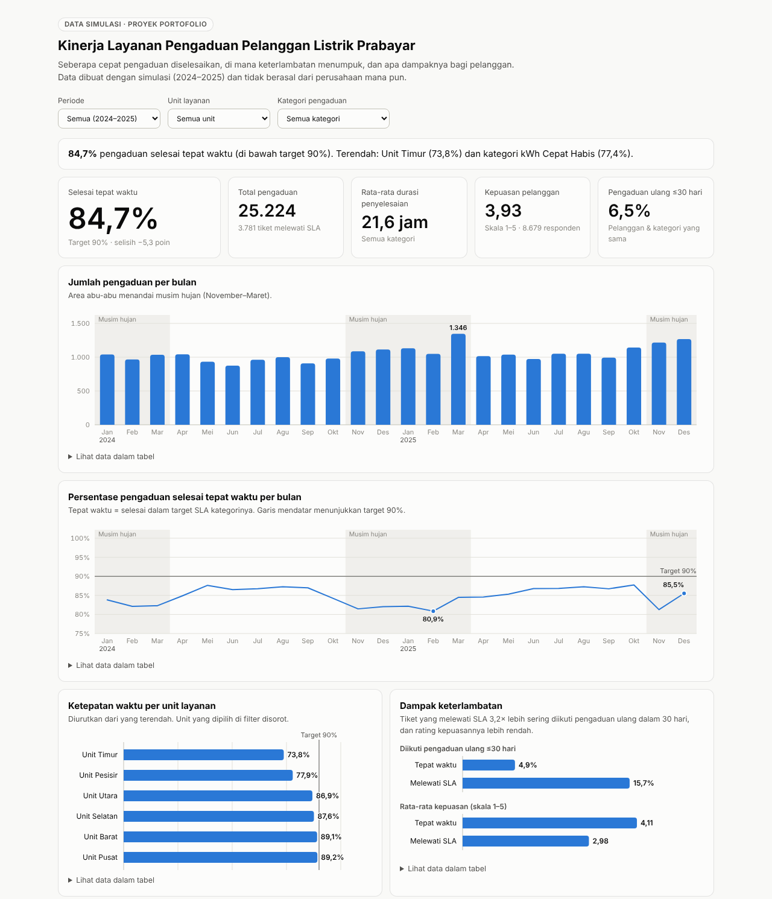

# Analisis Kinerja Layanan Pengaduan Pelanggan Listrik Prabayar

> **Data simulasi.** Seluruh data dibuat dengan skrip di proyek ini dan **tidak berasal dari PLN
> atau perusahaan mana pun**. Proyek ini menunjukkan alur kerja analisis data, dari data mentah
> sampai rekomendasi, bukan fakta tentang perusahaan nyata.

**Dashboard interaktif:** <https://ratuadisyaa.github.io/analisis-pengaduan-listrik-prabayar/>



## Ringkasan

Dari 25.224 tiket pengaduan (2024–2025), **84,7% selesai tepat waktu**, di bawah target 90%.
Keterlambatan menumpuk di **dua unit layanan** dan pada **musim hujan**. Pelanggan yang
pengaduannya terlambat ditangani **3,2× lebih sering melapor ulang** dalam 30 hari, dan rating
kepuasannya turun dari 4,11 menjadi 2,98.

## Latar belakang masalah

Pelanggan listrik prabayar membeli token untuk mengisi saldo listriknya. Jika token gagal
dimasukkan, meter rusak, atau listrik padam, rumah pelanggan bisa langsung tanpa listrik. Karena
itu, kecepatan menangani pengaduan berdampak langsung pada pelanggan.

**Skenario (fiktif):** tim layanan pelanggan sebuah penyedia listrik prabayar melihat jumlah
pengaduan terus naik dan target waktu penyelesaian sering terlewati. Mereka belum tahu di unit
mana, untuk jenis pengaduan apa, dan pada waktu kapan masalahnya paling parah.

### Mengapa ini mendesak

1. **Pelanggan langsung terdampak.** Untuk pelanggan prabayar, pengaduan yang lambat berarti rumah
   tanpa listrik lebih lama.
2. **Ada konsekuensi regulasi.** Di Indonesia, mutu pelayanan listrik diatur sebagai Tingkat Mutu
   Pelayanan (TMP) dalam Permen ESDM No. 27 Tahun 2017 beserta perubahannya. Jika indikator seperti
   lama gangguan melampaui batas, penyedia wajib memberi kompensasi, dan pelanggan prabayar
   menerimanya dalam bentuk tambahan energi (kWh)
   ([ESDM, 2020](https://esdm.go.id/id/berita-unit/direktorat-jenderal-ketenagalistrikan/pengawasan-tingkat-mutu-pelayanan-tmp-semakin-ketat);
   [Listrik Indonesia, 2026](https://listrikindonesia.com/detail/20179/listrik-sering-bermasalah-ini-aturan-soal-kompensasinya?page=1)).
   Target SLA di proyek ini adalah asumsi internal, bukan angka TMP.
3. **Biaya berlipat.** Pengaduan ulang berarti pekerjaan yang sama dikerjakan dua kali.

### Pertanyaan bisnis

1. Bagaimana tren jumlah pengaduan dan ketepatan waktu penyelesaian dari bulan ke bulan?
2. Kategori pengaduan apa yang paling banyak dan paling sering melewati target?
3. Unit layanan mana yang kinerjanya paling rendah?
4. Apakah keterlambatan membuat pelanggan melapor ulang dan menurunkan kepuasan?
5. Kapan (hari dan jam) beban pengaduan paling tinggi?

## Data

| | |
| --- | --- |
| Periode | Januari 2024 – Desember 2025 |
| Jumlah tiket | 25.602 baris mentah → 25.224 tiket setelah dibersihkan |
| Dimensi | 6 unit layanan, 7 kategori, 5 kanal pengaduan |
| Ukuran | durasi penyelesaian, ketepatan waktu terhadap SLA, rating kepuasan, pengaduan ulang |

Kamus kolom, target SLA, dan semua asumsi simulasi ada di [`data/README.md`](data/README.md).

## Alur kerja

| Langkah | Berkas | Alat |
| --- | --- | --- |
| 1. Membuat data simulasi | [`scripts/01_buat_data_simulasi.py`](scripts/01_buat_data_simulasi.py) | Python, NumPy |
| 2. Membersihkan data | [`scripts/02_bersihkan_data.py`](scripts/02_bersihkan_data.py) → [laporan](outputs/laporan_pembersihan.md) | Python, pandas |
| 3. Memuat ke database | [`scripts/03_muat_ke_database.py`](scripts/03_muat_ke_database.py) | SQLite |
| 4. Analisis dengan SQL | [`sql/01`–`06`](sql/) → [`outputs/hasil_query/`](outputs/hasil_query/) | SQL (CTE, window function, CASE) |
| 5. Dashboard | [`sql/07`–`08`](sql/), [`docs/index.html`](docs/index.html) | HTML, CSS, JavaScript (SVG) |

Masalah kualitas data yang ditangani: 378 baris ganda, 2.011 penulisan kategori tidak seragam,
1.218 nama unit tidak seragam, 2.617 tanggal berformat DD/MM/YYYY, 7.519 nilai daya bersatuan
"VA", 239 kanal kosong, dan 64 tiket dengan waktu selesai lebih awal dari waktu lapor.

## Temuan

**1. Ketepatan waktu 84,7%, di bawah target 90%, dan stagnan.** Angkanya 84,6% pada 2024 dan
84,9% pada 2025. Total 3.781 tiket melewati SLA. ([`sql/01`](sql/01_ringkasan_kpi.sql))

**2. Dua unit menyumbang hampir separuh keterlambatan.** Unit Timur (73,8%) dan Unit Pesisir
(77,9%) melayani 28% tiket tetapi menyumbang 45% tiket terlambat. Empat unit lain berada di
86,9–89,2%. Jika kedua unit mencapai rata-rata empat unit lain (88,3%), sekitar 880 tiket tidak
akan terlambat selama dua tahun. ([`sql/04`](sql/04_kinerja_unit.sql))

**3. Gangguan listrik padam adalah kategori terbesar dan paling sensitif musim.** Listrik padam
mencakup 24,4% tiket dengan ketepatan waktu 79,4%. Pada musim hujan, jumlahnya naik sekitar 52%
per bulan (320 dibanding 211 tiket), dan ketepatan waktunya turun dari 84,8% menjadi 74,3%.
Ketepatan waktu bulanan terendah terjadi pada Februari 2025 (80,9%).
([`sql/02`](sql/02_tren_bulanan.sql), [`sql/03`](sql/03_kinerja_kategori.sql))

**4. Pengaduan teknis yang butuh kunjungan lapangan paling sering terlambat.** kWh Cepat Habis
(77,4%) dan Meter Error (78,1%) berada di bawah rata-rata. Di Unit Pesisir, tiket Meter Error
mencapai 17,4 per 100 tiket (unit lain sekitar 10) dan hanya 64,8% yang selesai tepat waktu.
([`sql/03`](sql/03_kinerja_kategori.sql))

**5. Keterlambatan memicu pengaduan ulang dan menurunkan kepuasan.** Tiket yang melewati SLA
diikuti pengaduan ulang dalam 30 hari pada 15,7% kasus, dibanding 4,9% untuk tiket tepat waktu
(3,2×). Rating kepuasannya 2,98, dibanding 4,11. ([`sql/05`](sql/05_pengaduan_ulang.sql))

**6. Pengaduan token memuncak malam hari dan menjelang Lebaran.** 39,4% pengaduan token masuk
pukul 18.00–22.59. Volume bulanan tertinggi terjadi pada Maret 2025 (1.346 tiket), saat musim
hujan bertemu masa menjelang Lebaran. Tiket non-gangguan yang masuk akhir pekan juga lebih
jarang selesai tepat waktu (81,9% dibanding 88,2% pada hari kerja). ([`sql/06`](sql/06_pola_waktu.sql))

## Rekomendasi

| Masalah | Rekomendasi | Ukuran keberhasilan |
| --- | --- | --- |
| Unit Timur dan Pesisir jauh di bawah target | Tinjau jumlah petugas lapangan dan pantau ketepatan waktu setiap minggu | Kedua unit ≥ 85% dalam 6 bulan |
| Lonjakan gangguan saat musim hujan | Siagakan regu gangguan tambahan dan lakukan pemeliharaan jaringan sebelum November | Ketepatan waktu listrik padam musim hujan ≥ 80% |
| Meter Error menumpuk di Unit Pesisir | Program penggantian meter tua dan stok suku cadang di gudang unit | Tiket Meter Error Pesisir turun ke ±10 per 100 tiket |
| Pengaduan ulang setelah keterlambatan | Hubungi kembali pelanggan yang tiketnya melewati SLA dalam 7 hari; periksa meter sebelum menutup tiket Meter Error dan kWh Cepat Habis | Pengaduan ulang dari tiket terlambat < 10% |
| Puncak pengaduan token malam hari dan menjelang Lebaran | Tambah petugas call center dan WhatsApp pukul 18.00–23.00; promosikan panduan mandiri di aplikasi menjelang Lebaran | Ketepatan waktu kategori token tetap ≥ 90% pada bulan Lebaran |

## Keterbatasan

- **Data simulasi.** Pola dalam data mengikuti asumsi yang ditulis di [`data/README.md`](data/README.md),
  sehingga temuan di atas tidak menggambarkan perusahaan mana pun.
- **Target SLA adalah asumsi.** Hasil akan berbeda jika targetnya berbeda.
- **Rata-rata durasi dipengaruhi nilai ekstrem.** Persentase tepat waktu lebih tepat dipakai
  sebagai ukuran utama; median durasi bisa ditambahkan sebagai pengembangan berikutnya.
- **Survei kepuasan hanya diisi sekitar 35% pelanggan**, sehingga bisa bias terhadap pelanggan
  yang sangat puas atau sangat kecewa.

## Cara menjalankan

```bash
pip install -r requirements.txt
python jalankan_semua.py          # membersihkan data, membuat database, menjalankan query, menyiapkan dashboard
```

Lalu buka `docs/index.html` di browser. Database `database/pengaduan.db` juga bisa dibuka dengan
[DB Browser for SQLite](https://sqlitebrowser.org/) untuk menjalankan query di folder `sql/`.

## Struktur folder

```
├── data/
│   ├── raw/pengaduan_raw.csv            data mentah (simulasi)
│   ├── processed/pengaduan_bersih.csv   data bersih
│   └── README.md                        kamus kolom dan asumsi
├── scripts/                             langkah 01–05 (Python)
├── sql/                                 query analisis 01–06 dan data dashboard 07–08
├── database/pengaduan.db                database SQLite
├── outputs/                             laporan pembersihan dan hasil query
├── docs/                                dashboard (GitHub Pages)
└── jalankan_semua.py
```

## Penulis

**Ratu Adisya Famela** · [LinkedIn](https://www.linkedin.com/in/ratuadisyafamela)
